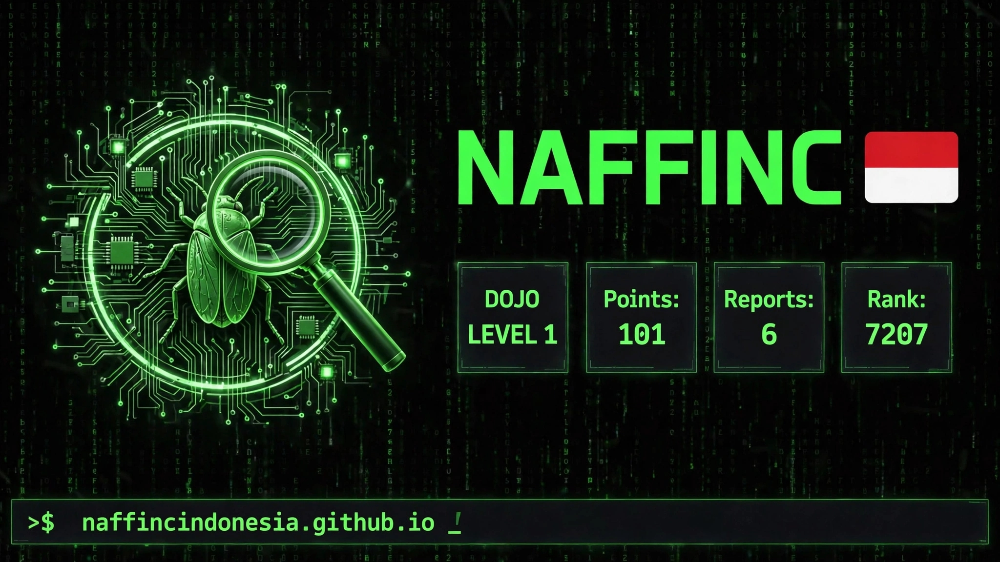

<!DOCTYPE html>
<html lang="id">
<head>
<meta charset="UTF-8">
<meta name="viewport" content="width=device-width, initial-scale=1.0">
<title>NAFFINC | Rank 7207</title>

</head>
<body>

root@naffinc:~# whoami > NAFFINC Indonesia 🇮🇩 > Bug Bounty Hunter | Cyber Security Researcher > naffincindonesia.github.io

root@naffinc:~# cat /etc/yeswehack/stats  
┌──────────────────────────────────────────┐ 
│ DOJO LEVEL 1 UNLOCKED                    │ 
│ Points: 101 | Reports: 6 | Rank: 7207    │ 
│ Was 10291 -> Now 7207 🚀                 │ 
│ Challenge: Dojo #55 Split Decision PWNED │ 
└──────────────────────────────────────────┘

root@naffinc:~# cat finding.txt  
[CRITICAL] CVSS 9.3 - CWE-639 IDOR 
POST /v1/support/bundles/preview 
Content-Type: multipart/form-data

root@naffinc:~# ls links/ <a href="https://yeswehack.com/hunters/naffinc">YesWeHack</a> | <a href="https://naffincindonesia.github.io">Website</a> | Indonesia 🇮🇩

© 2026 NAFFINC • Powered by GitHub Pages

</body>
</html>
